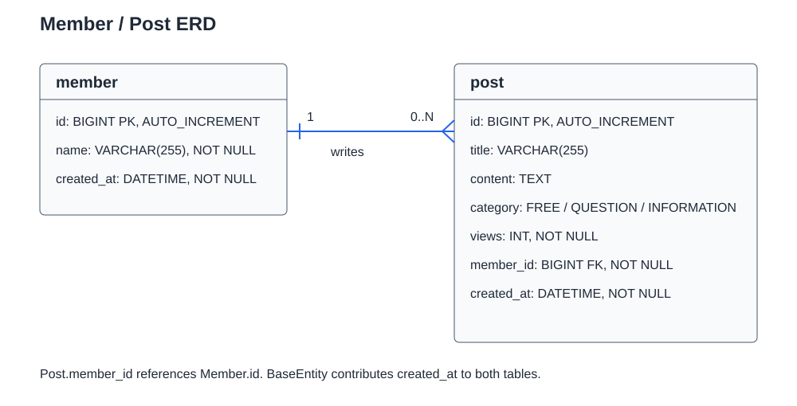
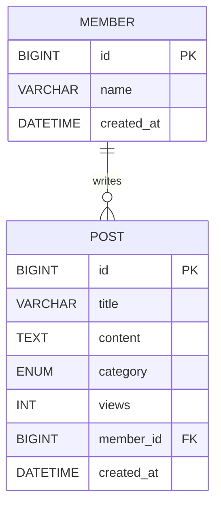
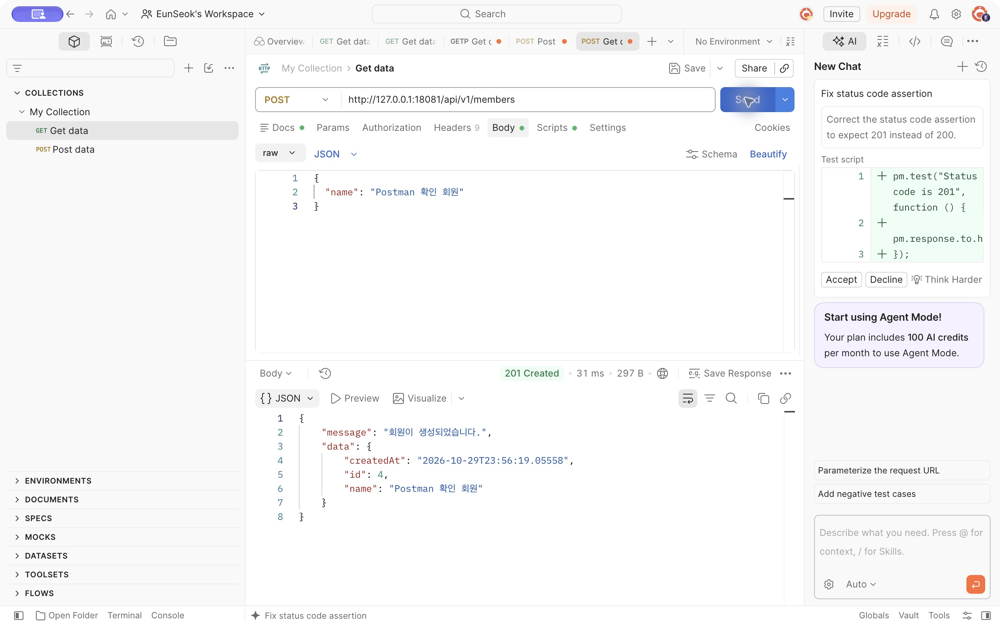
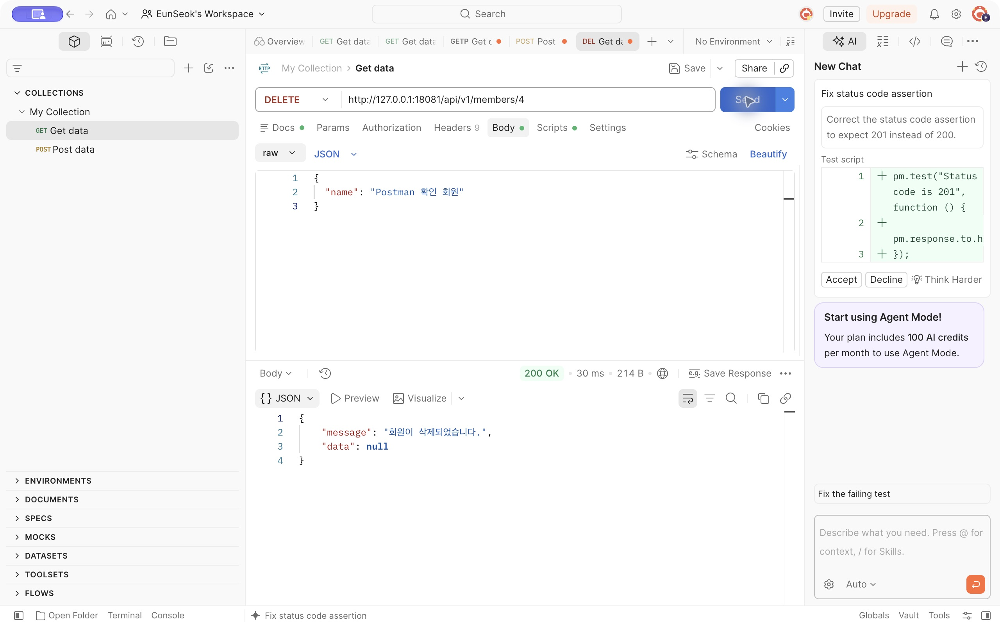
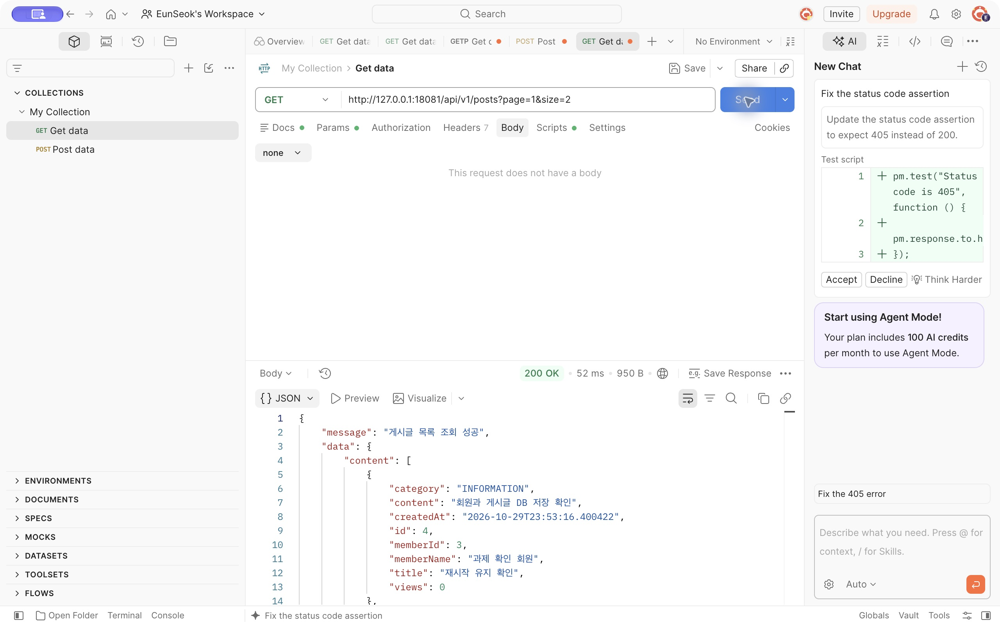

# 3차 과제

기존 게시글 CRUD를 MySQL·JPA로 전환하고 회원, 작성자 연관관계, 생성일, 최신순 페이지네이션을 추가했다. Lombok은 사용하지 않는다.

## ERD

Post는 반드시 한 Member를 참조하고, 한 Member는 게시글을 0개 이상 작성할 수 있다. `Post.member`가 FK를 관리하며 `ManyToOne(LAZY)`로 매핑한다. `BaseEntity`는 별도 테이블이 없고 두 엔티티에 `created_at`을 제공한다.

## 실행

MySQL의 `assignment` 데이터베이스를 사용한다. 실행 환경에 `SPRING_DATASOURCE_USERNAME`, `SPRING_DATASOURCE_PASSWORD`를 지정하고 Main을 실행한다. 계정 정보는 저장소에 넣지 않는다. Swagger: `http://localhost:8080/swagger-ui/index.html`.

기존 게시글이 있는 로컬 DB에는 `migration-assignment3.sql`을 한 번 적용했다. 기존 글을 삭제하지 않고 이전용 회원에 연결했으며, 알 수 없는 원래 작성일은 이전 시각으로 기록했다. 새 DB에서는 Hibernate가 스키마를 생성하므로 이 SQL을 실행하지 않는다.

## API

| 메서드 | 경로 | 내용 |
|---|---|---|
| POST | /api/v1/members | 이름으로 회원 생성, 201 |
| DELETE | /api/v1/members/{memberId} | 회원의 글을 먼저 삭제한 후 회원 삭제, 200 |
| POST | /api/v1/posts | title, content, category, memberId로 작성, 201 |
| GET | /api/v1/posts?page=1&size=10 | 생성일 내림차순 목록 |
| GET | /api/v1/posts/{postId} | 상세 조회 및 조회수 +1 |
| PUT | /api/v1/posts/{postId} | title, content 수정 |
| DELETE | /api/v1/posts/{postId} | 게시글 삭제 |

목록은 `createdAt DESC, id DESC`로 정렬한다. 날짜가 같아도 순서가 일정하다. 요청 page는 기존 API처럼 1부터 시작하고, 응답 Page의 number는 Spring 기준으로 0부터 시작한다. size는 1~100이다. 게시글 응답에는 기존 필드와 memberId, memberName, createdAt이 들어간다.

작성자 정보가 필요한 DTO는 서비스 트랜잭션 안에서 만든다. 목록에는 EntityGraph로 작성자를 함께 조회하며, open-in-view는 비활성화했다. 상세 조회·수정·삭제는 게시글 행에 쓰기 잠금을 사용하므로 조회수 갱신과 충돌하지 않도록 한다.

## 회원 탈퇴 정책

회원이 탈퇴하면 그 회원의 게시글을 먼저 삭제하고 회원을 삭제한다. 하나의 트랜잭션으로 처리하여 중간 오류가 발생하면 함께 롤백한다. 게시글 삭제를 flush한 다음 회원을 삭제해 FK를 위반하지 않는다. 회원 삭제와 게시글 생성은 같은 회원 행을 잠가 동시에 실행될 때 순서를 맞춘다. Post에서 Member로 REMOVE cascade를 걸지 않는다.

## 검증

`verification.md`에 실제 MySQL API 검증 결과를 기록했다. Postman 컬렉션은 `assignment3.postman_collection.json`이다. 컬렉션의 baseUrl은 기본 실행 주소이며, 별도 검증 서버를 쓰면 해당 포트로 변경한다.

별도 로컬 검증 서버(18081)에서 실제 실행한 Postman 화면이다. 기존 요청에 있던 테스트 스크립트의 기대 상태에 관한 제안은 API 응답과 별개이며, 응답 상태와 본문을 확인했다.

### 회원 생성 — 201 Created

### 회원 삭제 — 200 OK

### 최신순 목록과 작성자·생성일 — 200 OK

## 키워드 과제

### Page와 Slice

Page는 현재 목록과 전체 개수·전체 페이지 수를 제공하므로 페이지 번호 이동에 적합하다. 전체 개수를 얻기 위한 count 쿼리가 추가될 수 있다. Slice는 전체 개수 대신 다음 구간의 존재 여부를 제공하므로 더 보기나 무한 스크롤에 적합하다. 이번 목록은 전체 페이지 정보를 제공하기 위해 Page를 사용한다. 둘 다 offset이 커지면 조회 비용이 커질 수 있다. [Spring Data 공식 문서](https://docs.spring.io/spring-data/commons/reference/repositories/query-methods-details.html#repositories.special-parameters)

### DB 인덱스

인덱스는 조건에 맞는 행을 빠르게 찾기 위한 별도 자료구조다. 조회·조인·정렬에 도움을 줄 수 있지만 저장 공간과 INSERT·UPDATE·DELETE 시 유지 비용이 든다. 자주 실행하는 WHERE·JOIN·ORDER BY와 선택도를 보고 설계한다. 복합 인덱스는 컬럼 순서가 중요하며 왼쪽부터 이어지는 조건에 활용될 수 있다. 이번 최신순 조회에는 `(created_at, id)`가 검토 대상이지만, 실제 추가·성능 개선 과제는 수행하지 않았다. EXPLAIN과 실측으로 필요성을 판단한다. [MySQL 공식 문서](https://dev.mysql.com/doc/refman/9.7/en/mysql-indexes.html)

### 회원·게시글·댓글 생명주기

이번 구현은 회원 탈퇴 시 게시글도 삭제하는 정책이다. 게시글을 남기려면 탈퇴 회원을 익명화하거나 작성자 참조 정책을 바꾸는 등 별도 설계가 필요하다. 댓글은 이번에 구현하지 않았다. 향후 게시글에 종속된 댓글을 추가한다면 게시글 삭제 시 함께 삭제하는 정책을 선택할 수 있다. 회원이 작성한 타인의 글에 달린 댓글까지 지울지는 게시글 생명주기와 별도로 결정해야 한다.

### DB 무결성과 Cascade

PK는 각 행을 식별하고 FK는 참조 대상이 존재하도록 보장한다. NOT NULL은 필수값 누락을 막는다. JPA의 Cascade는 persist·merge·remove 같은 엔티티 작업을 연관 엔티티에 전파하는 옵션이며, DB의 ON DELETE CASCADE는 DB가 실행하는 참조 동작이다. 둘은 적용 위치와 실행 주체가 다르다. CascadeType.ALL에는 REMOVE도 포함되므로 공유하는 회원을 Post에서 함께 삭제하도록 설정하면 위험하다. 이번에는 자동 cascade 대신 서비스에서 게시글→회원 삭제 순서를 명시했다. 양방향 관계나 cascade 설정만으로 FK 무결성이 대체되지는 않는다. [Jakarta Persistence 공식 문서](https://jakarta.ee/specifications/persistence/3.2/apidocs/jakarta.persistence/jakarta/persistence/CascadeType.html), [MySQL FK 공식 문서](https://dev.mysql.com/doc/refman/9.7/en/create-table-foreign-keys.html)
