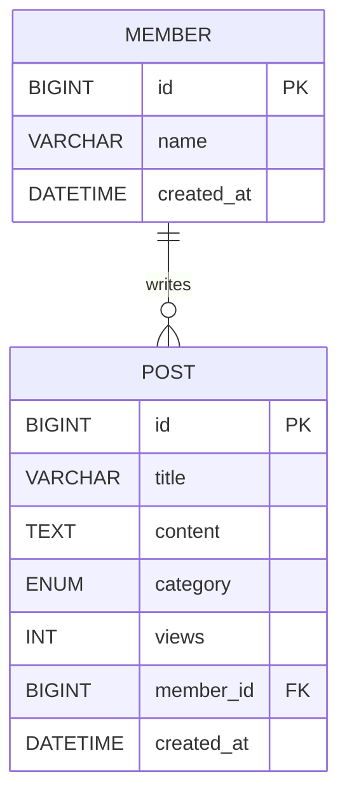

# 🔥 Pull requests

## 👷 과제 구현

### 필수과제

- [x] 기존 게시글 CRUD의 DB 전환
- [x] Member·Post ERD
- [x] 회원 생성·삭제 API
- [x] 작성자 연결 및 이름 응답
- [x] BaseEntity와 createdAt
- [x] 최신순 페이지네이션
- [x] 새 API Postman 화면 첨부

### 선택과제

- [ ] 심화 과제는 진행하지 않음

### 구현한 내용에 대해서 설명해주세요

기존 Map 기반 게시글 CRUD를 MySQL·JPA로 이전했습니다. 회원 생성·삭제, 게시글 작성자 연결, 작성자 이름 응답, BaseEntity의 createdAt, 최신순 페이지네이션을 추가했습니다.

- 회원 탈퇴 시 해당 회원의 게시글을 먼저 삭제합니다.
- 목록은 생성일과 ID 내림차순으로 정렬하며 page는 1부터 시작합니다.
- 목록은 작성자를 함께 조회하고, 응답 DTO는 트랜잭션 안에서 만듭니다.
- 조회수 갱신은 DB 행 잠금으로 보호합니다.
- 기존 게시글은 이전용 회원에 연결해 보존했습니다.

## ERD

## 검증

- Java 컴파일 통과
- 실제 MySQL에서 회원 생성·삭제 및 게시글 CRUD 검증
- 작성자·생성일 응답, 최신순 페이지네이션, 입력값 오류 검증
- 동시 상세 조회 20회에서 조회수 유실 없음 확인
- Postman 실제 화면 3개를 docs/screenshots/에 포함

### 구현하며 고민했던 내용

회원 탈퇴 시 글도 함께 삭제하는 정책을 선택했습니다. 하나의 트랜잭션에서 게시글 삭제를 먼저 DB에 반영하고 회원을 삭제해 FK를 지킵니다. 작성자와 생성일이 없던 기존 테스트 게시글은 삭제하지 않고 이전용 회원과 이전 시각을 사용해 보존했습니다. 회원 삭제와 게시글 생성은 같은 회원 행을 잠가 순서를 맞춥니다.

### 키워드 과제 정리내용

### Page와 Slice

Page는 현재 목록과 전체 개수·전체 페이지 수를 제공하므로 페이지 번호 이동에 적합하다. 전체 개수를 얻기 위한 count 쿼리가 추가될 수 있다. Slice는 전체 개수 대신 다음 구간의 존재 여부를 제공하므로 더 보기나 무한 스크롤에 적합하다. 이번 목록은 전체 페이지 정보를 제공하기 위해 Page를 사용한다. 둘 다 offset이 커지면 조회 비용이 커질 수 있다. [Spring Data 공식 문서](https://docs.spring.io/spring-data/commons/reference/repositories/query-methods-details.html#repositories.special-parameters)

### DB 인덱스

인덱스는 조건에 맞는 행을 빠르게 찾기 위한 별도 자료구조다. 조회·조인·정렬에 도움을 줄 수 있지만 저장 공간과 INSERT·UPDATE·DELETE 시 유지 비용이 든다. 자주 실행하는 WHERE·JOIN·ORDER BY와 선택도를 보고 설계한다. 복합 인덱스는 컬럼 순서가 중요하며 왼쪽부터 이어지는 조건에 활용될 수 있다. 이번 최신순 조회에는 `(created_at, id)`가 검토 대상이지만, 실제 추가·성능 개선 과제는 수행하지 않았다. EXPLAIN과 실측으로 필요성을 판단한다. [MySQL 공식 문서](https://dev.mysql.com/doc/refman/9.7/en/mysql-indexes.html)

### 회원·게시글·댓글 생명주기

이번 구현은 회원 탈퇴 시 게시글도 삭제하는 정책이다. 게시글을 남기려면 탈퇴 회원을 익명화하거나 작성자 참조 정책을 바꾸는 등 별도 설계가 필요하다. 댓글은 이번에 구현하지 않았다. 향후 게시글에 종속된 댓글을 추가한다면 게시글 삭제 시 함께 삭제하는 정책을 선택할 수 있다. 회원이 작성한 타인의 글에 달린 댓글까지 지울지는 게시글 생명주기와 별도로 결정해야 한다.

### DB 무결성과 Cascade

PK는 각 행을 식별하고 FK는 참조 대상이 존재하도록 보장한다. NOT NULL은 필수값 누락을 막는다. JPA의 Cascade는 persist·merge·remove 같은 엔티티 작업을 연관 엔티티에 전파하는 옵션이며, DB의 ON DELETE CASCADE는 DB가 실행하는 참조 동작이다. 둘은 적용 위치와 실행 주체가 다르다. CascadeType.ALL에는 REMOVE도 포함되므로 공유하는 회원을 Post에서 함께 삭제하도록 설정하면 위험하다. 이번에는 자동 cascade 대신 서비스에서 게시글→회원 삭제 순서를 명시했다. 양방향 관계나 cascade 설정만으로 FK 무결성이 대체되지는 않는다. [Jakarta Persistence 공식 문서](https://jakarta.ee/specifications/persistence/3.2/apidocs/jakarta.persistence/jakarta/persistence/CascadeType.html), [MySQL FK 공식 문서](https://dev.mysql.com/doc/refman/9.7/en/create-table-foreign-keys.html)

## 🚨 참고 사항

실제 실행 검증: docs/verification.md

ERD와 Postman 실제 스크린샷: docs/assignment3.md, docs/screenshots/

재실행용 요청 모음: docs/assignment3.postman_collection.json

Ref #11
